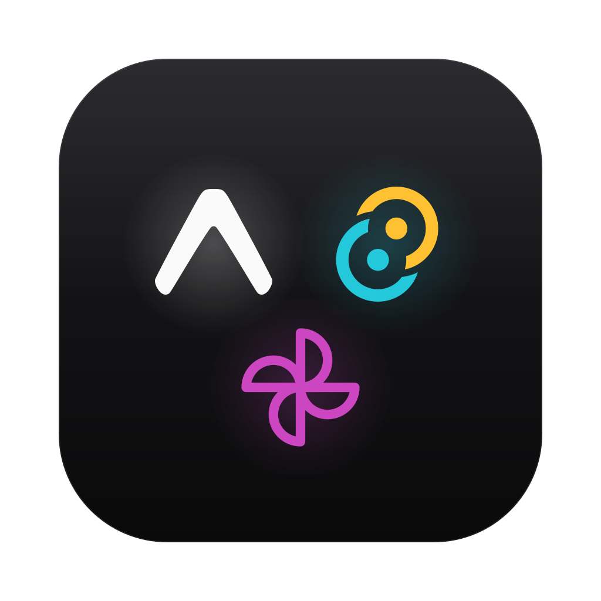

<p align="center">
  
</p>

<h1 align="center">Expo · Tauri · Uniwind</h1>

<p align="center">
  One React Native codebase styled with Uniwind, shipped to iOS, Android &amp; web with Expo and to macOS, Windows &amp; Linux with Tauri 2.
</p>

<p align="center">
  
</p>

<p align="center">
  <a href="https://expo.dev"></a>
  <a href="https://reactnative.dev"></a>
  <a href="https://tauri.app"></a>
  <a href="https://uniwind.dev"></a>
  <a href="https://www.typescriptlang.org/"></a>
  <a href="https://pnpm.io/"></a>
</p>

<p align="center">
  
  
  
  
  
  
</p>

<br />

## ✨ What is this?

A slim monorepo for an app that runs **everywhere from one React Native codebase**. Expo covers iOS, Android and the web; Tauri 2 wraps the same UI in a small native desktop shell built on the system webview. Uniwind brings Tailwind CSS 4 classes to React Native, so `className="bg-background text-foreground"` means the same thing on every platform.

Shared components, theme tokens and even the first screen live in `packages/`, so both apps stay thin. Replace the sample screen and start building. 🛠️

> 💡 The desktop app ships with Vite + react-native-web, but **Expo Web itself can be the Tauri frontend** with four lines of config. See [Expo Web inside Tauri](#-expo-web-inside-tauri).

## 🚀 Included

- 📱 Expo SDK 58 + Expo Router for iOS, Android and web (static rendering)
- 🖥️ Tauri 2 desktop shell for macOS, Windows and Linux
- ⚛️ React Native 0.88 everywhere, rendered on desktop through react-native-web + Vite 8
- 🎨 Uniwind + Tailwind CSS 4 with shared light/dark theme tokens
- 🧩 Shared `@app/ui` (WelcomeScreen, Button) and `@app/shared` (typed API client, constants)
- 🪄 Optional: run Expo Web inside Tauri and drop Vite entirely
- 📦 pnpm workspaces with a version catalog for React, React Native, Uniwind and friends
- 🚢 GitHub Actions for CI and cross-platform Tauri releases, plus EAS build profiles
- 🖼️ One SVG app icon used by every platform

## 🧰 Tech stack

| Layer | Choice |
| --- | --- |
| UI runtime | React Native `0.88` + React `19.3` |
| Mobile + web | Expo SDK `58` + Expo Router |
| Desktop | Tauri `2` + Vite `8` + react-native-web `0.21` |
| Styling | Uniwind `1.13` + Tailwind CSS `4` |
| Language | TypeScript `7` |
| Monorepo | pnpm `12` workspaces + catalog |
| CI / releases | GitHub Actions, `tauri-action`, EAS |

## 📁 Project layout

```text
expo-tauri-uniwind/
├── apps/
│   ├── expo/                  # iOS · Android · web
│   │   ├── src/app/           # Expo Router routes (index.tsx renders WelcomeScreen)
│   │   ├── src/global.css     # Tailwind + Uniwind + shared theme
│   │   ├── app.json           # Name, bundle id, icons, splash
│   │   ├── eas.json           # EAS build profiles
│   │   └── metro.config.js    # withUniwindConfig()
│   └── tauri/                 # macOS · Windows · Linux
│       ├── src/               # App.tsx (renders WelcomeScreen), main.tsx, global.css
│       ├── src-tauri/         # Rust shell, tauri.conf.json, icons
│       └── vite.config.ts     # rnw() + tailwindcss() + uniwind()
├── packages/
│   ├── ui/                    # Shared RN components, WelcomeScreen, theme.css tokens
│   └── shared/                # Platform-agnostic TS (API client, APP_NAME)
├── assets/icon.svg            # App icon source
├── .github/workflows/         # CI + Tauri release
└── pnpm-workspace.yaml        # Workspaces + version catalog
```

## ⚡ Quick start

### Prerequisites

- Node.js `26` or newer
- pnpm `12` (pinned via `packageManager`)
- Rust + the [Tauri prerequisites](https://v2.tauri.app/start/prerequisites/) for your OS
- Xcode and/or Android Studio for native Expo dev builds

### 1. Install dependencies

```bash
pnpm install
```

### 2. Run the desktop app

```bash
pnpm dev:tauri
```

Opens a Tauri window with Vite HMR on port `1420`.

### 3. Run the Expo app

```bash
pnpm dev:expo
```

Press `i`, `a` or `w` for iOS, Android or web. The project uses `expo-dev-client`, so the first native run needs a dev build: `pnpm --filter @app/expo ios` / `android`.

## 🧑‍💻 Development scripts

| Command | Description |
| --- | --- |
| `pnpm dev:tauri` | Tauri window with Vite HMR (`tauri dev`) |
| `pnpm dev:expo` | Expo dev server (`expo start`) |
| `pnpm build:tauri` | Native installers for the current OS (`tauri build`) |
| `pnpm typecheck` | `tsc` in every workspace package |
| `pnpm --filter @app/expo ios` | Native dev build on the iOS simulator / device |
| `pnpm --filter @app/expo android` | Native dev build on the Android emulator / device |
| `pnpm --filter @app/expo web` | Expo web in the browser |

## 🎨 Start building

1. Edit the shared first screen, [`packages/ui/src/WelcomeScreen.tsx`](packages/ui/src/WelcomeScreen.tsx). Both apps render it: [`apps/expo/src/app/index.tsx`](apps/expo/src/app/index.tsx) and [`apps/tauri/src/App.tsx`](apps/tauri/src/App.tsx).
2. Move anything both apps need into [`packages/ui`](packages/ui) (components) or [`packages/shared`](packages/shared) (logic).
3. Style with `className`. Semantic tokens (`background`, `foreground`, `muted`, `primary`, …) are defined once in [`packages/ui/theme.css`](packages/ui/theme.css) with light and dark variants, and dark mode follows the system everywhere. Add new tokens there, not in the apps.

```tsx
import { Button } from "@app/ui";
import { Text, View } from "react-native";

export const Hello = () => (
	<View className="flex-1 items-center justify-center gap-4 bg-background">
		<Text className="text-3xl font-bold text-foreground">Hello 👋</Text>
		<Button variant="secondary">Same on every platform</Button>
	</View>
);
```

## 🪄 Expo Web inside Tauri

Tauri only needs a frontend: a dev server URL and a folder of static files. **Expo Web provides both**, so the Expo app can run as the desktop app too. Only the `build` block of the Tauri config changes:

```jsonc
// apps/tauri/src-tauri/tauri.expo.conf.json
{
	"build": {
		"beforeDevCommand": "pnpm --filter @app/expo exec expo start --port 8081",
		"devUrl": "http://localhost:8081",
		"beforeBuildCommand": "pnpm --filter @app/expo exec expo export --platform web",
		"frontendDist": "../../expo/dist"
	}
}
```

Tauri merges a file like this on top of `tauri.conf.json`:

```bash
pnpm --filter @app/tauri tauri dev   --config src-tauri/tauri.expo.conf.json
pnpm --filter @app/tauri tauri build --config src-tauri/tauri.expo.conf.json
```

Or replace the `build` block in `tauri.conf.json` and remove the Vite parts of `apps/tauri` (`src/`, `index.html`, `vite.config.ts`, the Vite dependencies and scripts). What stays is a pure Rust shell around the Expo app.

Notes:
- `expo start` serves the web app on the Metro port, so `--web` isn't needed (it only opens a browser tab).
- The template's `web.output: "static"` and the existing Tauri CSP work as they are. The Expo screen renders with Uniwind styles and dark mode in both `tauri dev` and `tauri build`.
- Port `8081` is also used by `pnpm dev:expo`. To run both at once, change the port in `beforeDevCommand` and `devUrl`.

### Sharing one codebase with `isTauri()`

Inside the Tauri window, `@tauri-apps/api` reports that it's running in Tauri. Use that to branch config and features while sharing everything else:

```bash
pnpm --filter @app/expo add @tauri-apps/api
```

```ts
// apps/expo/src/runtime.ts
import { isTauri } from "@tauri-apps/api/core";
import { Platform } from "react-native";

export const runtime = isTauri() ? "desktop" : Platform.OS;
```

```ts
import { getVersion } from "@tauri-apps/api/app";
import Constants from "expo-constants";

import { runtime } from "@/runtime";

export const appVersion = async () =>
	runtime === "desktop" ? getVersion() : Constants.expoConfig?.version;
```

`isTauri()` returns `false` on iOS, Android and in a regular browser. The module only touches `window` inside its functions, so importing it on native is safe. Guard Tauri-only calls (`invoke`, plugins, window APIs) behind it.

For build-time differences, Tauri passes `TAURI_ENV_PLATFORM`, `TAURI_ENV_ARCH`, `TAURI_ENV_DEBUG`, … to `beforeDevCommand` / `beforeBuildCommand`, so an `app.config.ts` can read them as well.

## 🔁 Swapping Vite for another framework

The desktop app doesn't depend on Vite. Tauri accepts any frontend that produces static files (SPA, SSG or prerendered output), since there is no Node server inside the app. The real constraint is **Uniwind**, which ships bundler plugins for Metro and Vite only:

| Framework | Bundler | Uniwind | Tauri notes |
| --- | --- | --- | --- |
| **Vite + react-native-web** (this template) | Vite 8 | ✅ Official: [`uniwind/vite`](https://docs.uniwind.dev/vite) | SPA build to `dist/` |
| **Expo Web** | Metro | ✅ Official: [`uniwind/metro`](https://docs.uniwind.dev/api/metro-config) | `expo export`, [see above](#-expo-web-inside-tauri) |
| Next.js with webpack | webpack | 🧪 Community: [`uniwind-plugin-next`](https://github.com/a16n-dev/uniwind-plugin-next) | `output: "export"`; run `next dev/build --webpack` |
| Next.js with Turbopack (default in 16) | Turbopack | ❌ [Not supported](https://github.com/a16n-dev/uniwind-plugin-next/issues/9) | |
| React Router 7, TanStack Start, Astro | Vite | ⚠️ Not documented. They're Vite-based, so `uniwind/vite` is the plugin to try | SPA / static prerender mode only |
| Rsbuild, Rspack, webpack, Re.Pack | Rspack / webpack | ❌ No Uniwind plugin | |

Per the [Uniwind FAQ](https://docs.uniwind.dev/faq), official support covers React Native, Expo, Metro and Vite, with "no timeline" for Next.js. Vite 8 needs Uniwind `1.8+` (`1.10.1+` recommended).

## 🏷️ Make it yours

Replace the template names:

| What | Where |
| --- | --- |
| `@app/*` package scope | every `package.json` + imports |
| `com.example.app` | `apps/tauri/src-tauri/tauri.conf.json` (`identifier`), `apps/expo/app.json` (`ios.bundleIdentifier`, `android.package`) |
| `App` | `productName` + window title in `tauri.conf.json`, `name` / `slug` / `scheme` in `app.json`, `APP_NAME` in `packages/shared` |
| Tauri app version | `apps/tauri/package.json` |

**Icons:** edit [`assets/icon.svg`](assets/icon.svg), then regenerate the desktop icons:

```bash
pnpm --filter @app/tauri tauri icon ../../assets/icon.svg
```

It also writes `icons/android` and `icons/ios`, which this repo doesn't use, so delete them. Add `-p <size> -o <dir>` to render plain PNGs of any size instead, e.g. for Expo. Expo's images live in `apps/expo/assets/images`:

| File | Content |
| --- | --- |
| `icon.png` | 1024 px, full-bleed (iOS applies its own mask) |
| `android-icon-foreground.png` | adaptive foreground |
| `android-icon-background.png` | adaptive background |
| `android-icon-monochrome.png` | adaptive monochrome |
| `splash-icon.png` | splash image |
| `favicon.png` | web favicon |

## 📦 Adding dependencies

- Expo: `pnpm --filter @app/expo exec expo install <pkg>` picks SDK-compatible versions.
- Versions shared across packages (React, React Native, TypeScript, Uniwind, Tailwind) live in the `catalog` in `pnpm-workspace.yaml`. Reference them as `"catalog:"`.

## 🚢 Releases

**Tauri:** push a `v*` tag. [`.github/workflows/release-tauri.yml`](.github/workflows/release-tauri.yml) builds macOS (arm64 + x64), Linux and Windows and creates a draft GitHub Release. For signed and notarized macOS builds, add the `APPLE_*` secrets ([guide](https://v2.tauri.app/distribute/sign/macos/)).

**Expo:** via [EAS](https://docs.expo.dev/eas/):

```bash
cd apps/expo
npx eas-cli@latest init                                   # links the project, writes projectId
npx eas-cli@latest build --profile development            # dev client
npx eas-cli@latest build --profile production --auto-submit
```

Profiles are in [`apps/expo/eas.json`](apps/expo/eas.json).

## 🧩 Optional tooling

Intentionally not included. Pick what you like:

- **Lint + format:** [Biome](https://biomejs.dev) (`pnpm add -Dw @biomejs/biome && pnpm biome init`) or [oxlint](https://oxc.rs/docs/guide/usage/linter) + [oxfmt](https://oxc.rs/docs/guide/usage/formatter).
- **Task caching:** [Turborepo](https://turborepo.com) once builds get slow.

CI ([`.github/workflows/ci.yml`](.github/workflows/ci.yml)) runs typecheck, the Tauri frontend build, the Expo export, `cargo fmt` and `clippy`.

## 🩹 Troubleshooting

If `pnpm dev:tauri` fails because port `1420` is in use, another Vite dev server is still running. The port is fixed (`strictPort`) because Tauri expects it.

If Expo Web inside Tauri can't start on port `8081`, `pnpm dev:expo` is probably running. Stop it or pick another port (see [above](#-expo-web-inside-tauri)).

On Linux, Tauri needs the WebKitGTK development packages: `libwebkit2gtk-4.1-dev libappindicator3-dev librsvg2-dev patchelf`.
